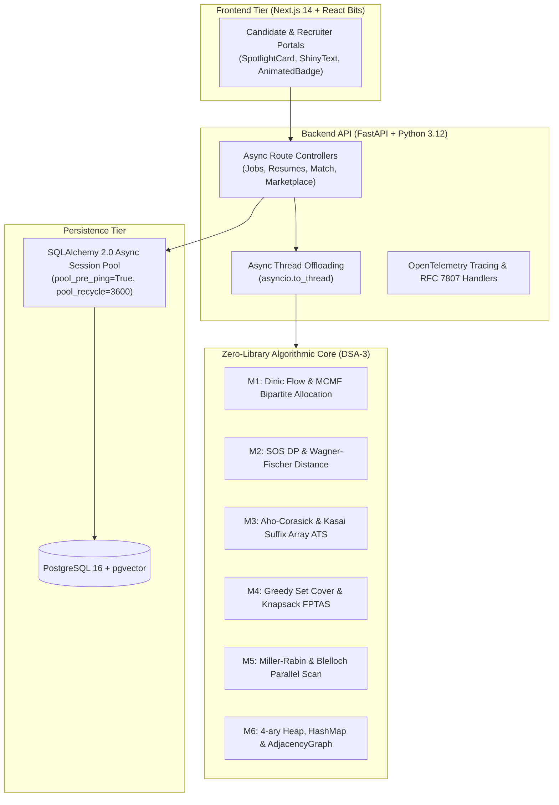

# Talent Marketplace & Resume Matching Engine

[](https://github.com/tejaswin-amara/Resume_Job_Matching_Talent_Marketplace_Engine/actions)
[](https://web-blond-alpha-o8dah7izh0.vercel.app)
[](https://tejaswin-amara.github.io/Resume_Job_Matching_Talent_Marketplace_Engine/)
[](tests/)
[](web/tests/)
[](pyproject.toml)
[](web/)
[](https://reactbits.dev/)
[](LICENSE)

> 🚀 **Live Production Website**: [web-blond-alpha-o8dah7izh0.vercel.app](https://web-blond-alpha-o8dah7izh0.vercel.app)
> 📚 **Interactive DSA-3 Concepts GitHub Page**: [tejaswin-amara.github.io/Resume_Job_Matching_Talent_Marketplace_Engine](https://tejaswin-amara.github.io/Resume_Job_Matching_Talent_Marketplace_Engine/)

A high-throughput, enterprise-grade talent marketplace and automated candidate matching engine. Combines a zero-external-dependency algorithmic core (**DSA-3 Modules M1–M6**) with hybrid semantic vector search, PostgreSQL/pgvector persistence, and an interactive Next.js 14 frontend powered exclusively by [React Bits](https://reactbits.dev/).

---

## 🏛️ System Architecture



---

## 🎯 Hybrid ATS Matching Formula

Candidates are evaluated across four weighted dimensions using normalized scoring:

$$
\text{Score} = 100 \times \left(0.40 \cdot S_{\text{semantic}} + 0.35 \cdot S_{\text{skill}} + 0.15 \cdot S_{\text{experience}} + 0.10 \cdot S_{\text{education}}\right)
$$

- **$S_{\text{semantic}}$**: Cosine similarity between `all-MiniLM-L6-v2` 384-dimensional dense embeddings stored in PostgreSQL `pgvector`.
- **$S_{\text{skill}}$**: Exact multi-keyword matching via Aho-Corasick combined with Wagner-Fischer fuzzy tolerance ($\le 2$ edit distance).
- **$S_{\text{experience}}$**: Non-linear experience penalty/bonus capped at job requirement bounds.
- **$S_{\text{education}}$**: Ordinal qualification level mapping (PhD > Master's > Bachelor's > Associate's).

---

## ⚡ DSA-3 Curriculum Mapping (25CS2103E) & Interactive Showcase

> **🌐 Live GitHub Pages Showcase:** [https://tejaswin-amara.github.io/Resume_Job_Matching_Talent_Marketplace_Engine/](https://tejaswin-amara.github.io/Resume_Job_Matching_Talent_Marketplace_Engine/)  
> **Interactive Next.js Portal:** Accessible at route `/dsa-3` in the Next.js frontend application.  
> **Standalone Web Showcase:** Served directly from [`docs/index.html`](docs/index.html) powered by **GSAP 3.12+**, **Lenis 1.1+**, and **React Bits** UI components.

This project implements the comprehensive **Outside-In Project-Based Learning (PBL)** syllabus for **Data Structures & Algorithms - 3 (25CS2103E)**:

| Module & CO | Algorithmic Concept | Mathematical Complexity | Where Implemented in Codebase | Role in Production Engine |
|---|---|---|---|---|
| **M1 (CO1)** | **Zero-Library Core** | $O(1)$ Policy | [`docs/architecture/adr/0001-zero-library-core.md`](docs/architecture/adr/0001-zero-library-core.md) | Enforces hand-crafted structures without external algorithmic packages |
| **M1 (CO1)** | **4-ary Quaternary Heap** | $O(\log_4 n)$ Push/Pop | [`core/engine/structures/priority_queue.py`](core/engine/structures/priority_queue.py) | Cache-conscious priority queue for Dijkstra & MCMF shortest-path passes |
| **M1 (CO1)** | **Custom Resizable Hash Map** | $O(1)$ Amortized | [`core/engine/structures/hash_map.py`](core/engine/structures/hash_map.py) | Polynomial rolling hash key index with collision chaining & load factor rebalancing |
| **M1 (CO1)** | **Residual Adjacency Graph** | $O(V + E)$ Traversal | [`core/engine/structures/adjacency_graph.py`](core/engine/structures/adjacency_graph.py) | Edge structures with capacities, flows, and reverse residual pointers |
| **M2 (CO2)** | **Knuth-Morris-Pratt (KMP)** | $O(N + M)$ Time, $O(M)$ Space | [`core/engine/string/kmp.py`](core/engine/string/kmp.py) | Deterministic linear-time exact keyword pattern search across resumes |
| **M2 (CO2)** | **Z-Algorithm (Z-Function)** | $O(N)$ Time, $O(N)$ Space | [`core/engine/string/z_algorithm.py`](core/engine/string/z_algorithm.py) | Linear string preprocessor computing LCP of string with its suffixes |
| **M2 (CO2)** | **Rabin-Karp Rolling Hash** | $O(N + M)$ Avg, Double-Hash | [`core/engine/string/rabin_karp.py`](core/engine/string/rabin_karp.py) | Multi-window 64-bit polynomial rolling hash suppressing false positives |
| **M2 (CO2)** | **Aho-Corasick Automaton** | $O(N + K)$ Search | [`core/engine/string/aho_corasick.py`](core/engine/string/aho_corasick.py) | Trie with failure links scanning 50,000+ technical skill taxonomy terms in one pass |
| **M2 (CO2)** | **Suffix Array & Kasai LCP** | $O(N \log^2 N)$ SA, $O(N)$ LCP | [`core/engine/string/suffix_array.py`](core/engine/string/suffix_array.py) | Longest Common Substring (LCS) document similarity and duplicate detection |
| **M3 (CO3)** | **Wagner-Fischer Distance** | $O(N \cdot M)$ Time, $O(M)$ Space | [`core/engine/dp/wagner_fischer.py`](core/engine/dp/wagner_fischer.py) | Levenshtein edit distance with $\le 2$ edit tolerance for typo-resistant skill matches |
| **M3 (CO3)** | **Smith-Waterman Alignment**| $O(N \cdot M)$ Time, Affine Gaps | [`core/engine/dp/sequence_alignment.py`](core/engine/dp/sequence_alignment.py) | Subsequence alignment with gap penalty for DNA & credential phrase alignment |
| **M3 (CO3)** | **Bitmask DP (Held-Karp TSP)** | $O(2^n \cdot n^2)$ Time | [`core/engine/dp/bitmask_tsp.py`](core/engine/dp/bitmask_tsp.py) | Exact minimal recruiter multi-city campus hiring tour routing (up to 20 cities) |
| **M3 (CO3)** | **Tree DP with Rerooting** | $O(V)$ Time, $O(V)$ Space | [`core/engine/dp/tree_rerooting.py`](core/engine/dp/tree_rerooting.py) | Computes corporate reporting tree centroids and hierarchy diameters |
| **M3 (CO3)** | **Sum Over Subsets (SOS DP)** | $O(n \cdot 2^n)$ Time | [`core/engine/dp/sos_dp.py`](core/engine/dp/sos_dp.py) | Fast subset profile aggregation for cumulative skill coverage distributions |
| **M4 (CO4)** | **Edmonds-Karp Max-Flow** | $O(V \cdot E^2)$ Time | [`core/engine/flow/edmonds_karp.py`](core/engine/flow/edmonds_karp.py) | BFS augmenting paths in residual capacity network ensuring termination |
| **M4 (CO4)** | **Dinic's Algorithm** | $O(E \sqrt{V})$ on Bipartite | [`core/engine/flow/dinic.py`](core/engine/flow/dinic.py) | Level graph BFS + DFS blocking flows with pointer pruning for market clearing |
| **M4 (CO4)** | **Min-Cost Max-Flow (MCMF)**| $O(F \cdot E \log V)$ Time | [`core/engine/flow/min_cost_max_flow.py`](core/engine/flow/min_cost_max_flow.py) | Successive Shortest Path (SSP) maximizing talent fit scores under capacity bounds |
| **M4 (CO4)** | **Max-Flow / Min-Cut Duality**| $O(V + E)$ Cut Partition | [`core/engine/flow/min_cut.py`](core/engine/flow/min_cut.py) | Identifies marketplace hiring bottlenecks and capacity deficit edges |
| **M4 (CO4)** | **Marketplace Network Model**| Source $\to$ Cands $\to$ Jobs $\to$ Sink | [`core/engine/flow/marketplace_network.py`](core/engine/flow/marketplace_network.py) | Bipartite capacity-constrained network powering `/api/v1/marketplace/allocate` |
| **M5 (CO5)** | **Greedy Set Cover Approx** | $(1 + \ln n)$ Ratio Guarantee | [`core/engine/approx/greedy_set_cover.py`](core/engine/approx/greedy_set_cover.py) | Powers `/api/v1/marketplace/team-builder` to assemble minimum-cost squads |
| **M5 (CO5)** | **Vertex Cover 2-Approx** | $OPT \le \|C\| \le 2 \cdot OPT$ | [`core/engine/approx/vertex_cover.py`](core/engine/approx/vertex_cover.py) | Maximal matching reduction resolving conflicting interview bookings |
| **M5 (CO5)** | **Knapsack FPTAS** | $(1 - \varepsilon)$ Ratio Guarantee | [`core/engine/approx/knapsack_fptas.py`](core/engine/approx/knapsack_fptas.py) | Value-scaled DP optimizing talent hiring within strict recruiter budget ceilings |
| **M6 (CO6)** | **Miller-Rabin Primality** | Probabilistic $< 4^{-k}$ Error | [`core/engine/randomised/miller_rabin.py`](core/engine/randomised/miller_rabin.py) | Validates 256-bit cryptographic candidate credential verification tokens |
| **M6 (CO6)** | **Reservoir Sampling** | $O(N)$ Time, $O(k)$ Space | [`core/engine/randomised/reservoir_sampling.py`](core/engine/randomised/reservoir_sampling.py) | Uniform random sampling from high-velocity unbounded live applicant feeds |
| **M6 (CO6)** | **Blelloch Parallel Scan** | $T_1 = O(n)$, $T_\infty = O(\log n)$ | [`core/engine/randomised/parallel_primitives.py`](core/engine/randomised/parallel_primitives.py) | Work-efficient parallel prefix-scan for candidate batch scoring aggregations |
| **M6 (CO6)** | **Parallel Tree Reduction** | $T_1 = O(n)$, $T_\infty = O(\log n)$ | [`core/engine/randomised/parallel_primitives.py`](core/engine/randomised/parallel_primitives.py) | Brent's Theorem bounded parallel reduction for multi-dimensional score summing |

---

## 🚀 Quick Start

### 1. Run with Docker Compose (Recommended)

```bash
docker compose up --build -d
```

- **Frontend Application:** `http://localhost:3000`
- **FastAPI Documentation:** `http://localhost:8000/docs`
- **Health Live Probe:** `http://localhost:8000/health/live`
- **Health Ready Probe:** `http://localhost:8000/health/ready`

### 2. Local Development Setup

#### Backend (Python 3.12 + UV)
```bash
# Install uv and sync dependencies
uv sync

# Run database migrations
uv run alembic upgrade head

# Start FastAPI development server
uv run uvicorn api.app:create_app --factory --reload --port 8000
```

#### Frontend (Next.js 14 + pnpm)
```bash
cd web
pnpm install
pnpm dev
```

---

## 📡 API Specification & Endpoints

| Method | Endpoint | Description | Response Model |
|---|---|---|---|
| `GET` | `/health/live` | Liveness probe for orchestrators/K8s | `HealthResponse` (200) |
| `GET` | `/health/ready` | Readiness probe verifying PostgreSQL connection | `HealthResponse` (200 / 503) |
| `POST` | `/api/v1/jobs` | Create a job requisition with skill requirements | `JobResponse` (200) |
| `GET` | `/api/v1/jobs` | Paginated listing of open job requisitions | `list[JobResponse]` (200) |
| `GET` | `/api/v1/jobs/{id}/matches` | View candidate leaderboards for a job | `list[MatchResultResponse]` (200) |
| `POST` | `/api/v1/resumes/upload` | Upload & parse resume file (PDF, DOCX, TXT) | `CandidateResponse` (200) |
| `POST` | `/api/v1/resumes/parse-text` | Parse raw unstructured resume text | `CandidateResponse` (200) |
| `POST` | `/api/v1/match/adhoc` | Run ad-hoc 4-signal hybrid ATS match | `MatchResultResponse` (200) |
| `POST` | `/api/v1/marketplace/allocate` | Run Dinic's capacity-constrained allocation (Maximum Cardinality) | `MarketplaceAllocation` (200) |
| `GET` | `/api/v1/marketplace/bottlenecks` | Identify candidate/job bottleneck cuts | `BottleneckResponse` (200) |
| `POST` | `/api/v1/marketplace/team-builder`| Greedy set-cover minimum cost team | `TeamBuilderResponse` (200) |

---

## 🧪 Comprehensive Verification Matrix

The codebase is protected by automated quality gates:

```bash
# 1. Linting & Formatting (0 errors)
uv run ruff check .

# 2. Frontend Vitest Unit Suite (9/9 passed)
pnpm --dir web test

# 3. Next.js Production Build (14/14 static pages generated)
pnpm --dir web build

# 4. Backend & Algorithmic Test Suite (245/245 passed)
uv run pytest tests/unit/ tests/contract/ tests/e2e/ tests/benchmarks/ tests/stress/ -q

# 5. Playwright End-to-End Suite
pnpm --dir web exec playwright test
```

---

## 📂 Repository Layout

```
├── api/                  # FastAPI Application & Asynchronous Controllers
│   ├── controllers/      # Health, Jobs, Resumes, Match, Marketplace
│   ├── telemetry/        # OpenTelemetry Instrumentation & Tracing
│   ├── errors.py         # RFC 7807 Problem Detail Handlers
│   └── schemas/          # Pydantic v2 Contract Specifications
├── core/
│   ├── engine/           # Zero-Library DSA-3 Algorithmic Core (M1–M6)
│   ├── parsers/          # Magic-Byte PDF, DOCX, Text Document Parsers
│   └── scoring/          # Hybrid ATS Scoring Engine & Skill Extractor
├── db/                   # PostgreSQL 16 Models, Pgvector, Session Pooling
├── migrations/           # Alembic Asynchronous Migration Scripts
├── web/                  # Next.js 14 App Router Frontend
│   ├── src/app/          # Candidate Portal, Recruiter Portal, Market Allocation
│   ├── src/components/   # React Bits UI Components (SpotlightCard, ShinyText, etc.)
│   └── tests/            # Vitest Component Tests & Playwright E2E
├── tests/                # 245+ Pytest Test Suites
│   ├── benchmarks/       # Empirical Big-O Complexity Validation
│   ├── contract/         # Schemathesis OpenAPI 3.1 Contract Fuzzing
│   ├── e2e/              # Multi-tier End-to-End User Scenarios
│   ├── integration/      # Testcontainers PostgreSQL/Pgvector Integration
│   ├── stress/           # Heavy Concurrency & Algorithmic Oracle Tests
│   └── unit/             # Isolated Module Unit Tests
├── .github/workflows/    # CI/CD (UV, Ruff, Gitleaks, Semgrep, Trivy, Vitest, Pytest)
├── docker-compose.yml    # Multi-Container Deployment Profile
└── pyproject.toml        # Python Packaging & Dependency Manifest
```

---

## 📄 License

This project is licensed under the [MIT License](LICENSE).
